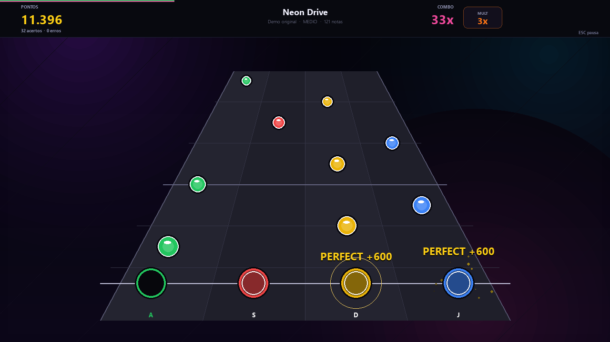
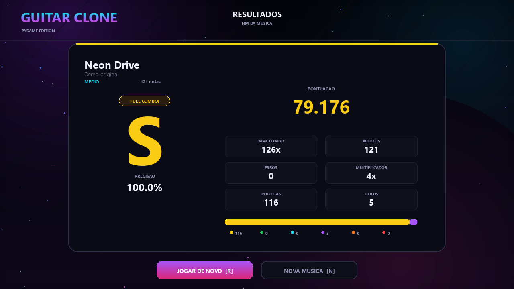
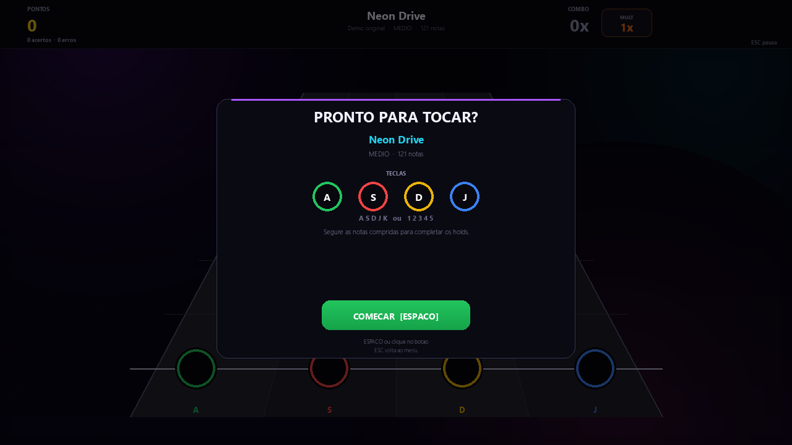

# Guitar Clone

Repositório do projeto: **Guitar Clone Web**.

Jogo de ritmo inspirado em Guitar Hero: notas descem em uma pista de 3 a 5 faixas
e devem ser acionadas no tempo da música. A chart é gerada automaticamente a
partir do áudio, e a partida termina com pontuação, precisão e nota de S a F.

```
backend/        API Flask (busca Spotify, download YouTube, análise, chart, cache)
frontend/       interface web em React + Vite (opcional)
pygame-client/  cliente desktop em PyGame (jogo completo)
```

> Nos comandos abaixo, troque `C:\Projetos-Pessoais\guitar-clone-web` e
> `~/guitar-clone-web` pelo caminho do seu clone. Os exemplos usam `python`; se
> você usa o launcher do Windows, pode trocar por `py -3`.

---

## 1. Identificação

| Campo | Valor |
| --- | --- |
| Trabalho | A3 — Desenvolvimento de um Jogo |
| Unidade curricular | Usabilidade, desenvolvimento web, mobile e jogos |
| Professor | Patricia Vitorino Gomes e Fabio Tadeu Doro |
| Grupo | `Guitar Clone` |
| Nome provisório do jogo | `Guitar Clone` (o nome técnico do repositório é `Guitar Clone Web`) |
| Repositório | <https://github.com/Kaio-AH/Guitar-Clone-Web> (público) |

Integrantes:

| # | Nome completo | RA |
| --- | --- | --- |
| 1 | Kaio Alcantara Henriques | 82610454 |
| 2 | Rafael Correia Ziroldo | 825151686 |
| 3 | Gustavo Felipe | 8261104111 |
| 4 | Renan Santos de Brito | 8261104906 |
| 5 | Gabriel Lourenço | 8261112697 |
| 6 | Murillo Rossetti Vieira | 826185996 |
| 7 | Pedro Andrade Dionísio da Silva | 8261103786 |

---

## 2. Descrição

O Guitar Clone coloca o jogador diante de uma “setlist”: ele pode buscar uma
música no Spotify, enviar um arquivo de áudio local ou usar a faixa demo original
`Neon Drive`, gerada pelo próprio jogo. O backend baixa o áudio, analisa batidas e
alturas com `librosa` e transforma isso em notas `tap` e `hold` na pista. Acertos
no tempo correto aumentam o combo e o multiplicador; erros quebram o combo. Ao
fim da música aparece a pontuação, a precisão, o maior combo e uma nota de S a F.

**Premissa:** você é o guitarrista de uma apresentação e precisa conduzir a música
até o final, seguindo a chart gerada a partir da faixa escolhida. O conflito é o
tempo: cada nota passa em um instante exato e exige a tecla certa na hora certa.

Essa premissa aparece no jogo de forma mínima, por meio do tema da faixa e do
desfecho mostrado na tela de resultados.

---

## 3. Como rodar

### 3.1 Pré-requisitos

| Ferramenta | Versão | Para quê |
| --- | --- | --- |
| Python | 3.10+ | backend e cliente PyGame |
| Node.js | 20+ | frontend e solver JS do yt-dlp |
| ffmpeg | qualquer recente | conversão de áudio do YouTube |
| Deno | opcional | solver EJS do yt-dlp (alternativa ao Node) |

O backend escuta em `http://127.0.0.1:5000` (bind `0.0.0.0:5000`), o frontend
Vite em `http://localhost:5173` e o cliente PyGame consome a API na porta 5000.

### 3.2 Instalação

#### PowerShell (Windows)

```powershell
cd C:\Projetos-Pessoais\guitar-clone-web

# backend
python -m venv backend\.venv
.\backend\.venv\Scripts\Activate.ps1
python -m pip install --upgrade pip
pip install -r backend\requirements.txt
deactivate

# cliente PyGame
python -m venv pygame-client\.venv
.\pygame-client\.venv\Scripts\Activate.ps1
python -m pip install --upgrade pip
pip install -r pygame-client\requirements.txt
deactivate

# frontend (opcional)
cd frontend
npm install
cd ..
```

Se o PowerShell bloquear a ativação do venv:

```powershell
Set-ExecutionPolicy -Scope Process -ExecutionPolicy Bypass
```

Instale o ffmpeg (necessário para o yt-dlp converter o áudio):

```powershell
winget install Gyan.FFmpeg
# ou: choco install ffmpeg
```

#### WSL (Ubuntu/Debian)

```bash
sudo apt update
sudo apt install -y python3 python3-venv python3-pip ffmpeg libsndfile1

# prefira clonar/copiar para o filesystem do Linux: /mnt/c é lento para venv
cd ~/guitar-clone-web

python3 -m venv backend/.venv
source backend/.venv/bin/activate
python -m pip install --upgrade pip
pip install -r backend/requirements.txt
deactivate

python3 -m venv pygame-client/.venv
source pygame-client/.venv/bin/activate
python -m pip install --upgrade pip
pip install -r pygame-client/requirements.txt
deactivate

# frontend (opcional)
cd frontend
npm install
cd ..
```

O `yt-dlp` atual precisa de um runtime JS para o YouTube. Instale **Node.js 20+**
(por exemplo via [nvm](https://github.com/nvm-sh/nvm) ou Nodesource) ou **Deno**
e garanta que o comando (`node` ou `deno`) esteja no `PATH` do processo do backend.

### 3.3 Credenciais do Spotify

Crie um app em <https://developer.spotify.com/dashboard> e use as credenciais
via variáveis de ambiente. **Nunca comite `SPOTIFY_CLIENT_ID`/`SPOTIFY_CLIENT_SECRET`.**

```powershell
Copy-Item backend\.env.example backend\.env
notepad backend\.env
```

```bash
cp backend/.env.example backend/.env
nano backend/.env
```

```dotenv
SPOTIFY_CLIENT_ID=seu_client_id
SPOTIFY_CLIENT_SECRET=seu_client_secret
```

O backend carrega `backend/.env` automaticamente (via `python-dotenv`) e não
sobrescreve variáveis já definidas no ambiente. O `.env` está no `.gitignore`.
Sem Spotify configurado o backend sobe normalmente, mas a busca fica
desabilitada — nesse caso use a **demo** (`F2`) ou envie um arquivo local (`U`).
Mais detalhes no **Apêndice A**.

### 3.4 Rodar o jogo

#### Demo local (sem backend, sem internet)

```powershell
cd C:\Projetos-Pessoais\guitar-clone-web\pygame-client
python -m venv .venv
.\.venv\Scripts\python.exe -m pip install -r requirements.txt
.\.venv\Scripts\python.exe main.py --demo
```

```bash
cd ~/guitar-clone-web/pygame-client
python3 -m venv .venv
.venv/bin/python -m pip install -r requirements.txt
.venv/bin/python main.py --demo
```

#### Jogo completo — terminal 1 (backend)

O backend imprime emojis no console. No Windows, sem `PYTHONIOENCODING=utf-8`,
ele pode encerrar com `UnicodeEncodeError`.

```powershell
cd C:\Projetos-Pessoais\guitar-clone-web\backend
$env:PYTHONIOENCODING = "utf-8"
$env:SPOTIFY_CLIENT_ID = "seu_client_id"
$env:SPOTIFY_CLIENT_SECRET = "seu_client_secret"
.\.venv\Scripts\python.exe guitar-clone-back.py
```

```bash
cd ~/guitar-clone-web/backend
export PYTHONIOENCODING=utf-8
export SPOTIFY_CLIENT_ID="seu_client_id"
export SPOTIFY_CLIENT_SECRET="seu_client_secret"
.venv/bin/python guitar-clone-back.py
```

Teste rápido em outro terminal:

```powershell
Invoke-WebRequest http://127.0.0.1:5000/health -UseBasicParsing
```

```bash
curl http://127.0.0.1:5000/health
```

#### Jogo completo — terminal 2 (cliente)

```powershell
cd C:\Projetos-Pessoais\guitar-clone-web\pygame-client
.\.venv\Scripts\python.exe main.py
```

Atalho equivalente: `.\run.bat`.

```bash
cd ~/guitar-clone-web/pygame-client
.venv/bin/python main.py
```

Em Windows 11 com WSL2 + WSLg a janela e o áudio funcionam direto. No Windows 10
é necessário um servidor X e PulseAudio; nesse caso é mais simples rodar o
cliente no Windows e deixar o backend no WSL.

Opções do cliente:

```bash
python main.py --demo                          # demo local, sem backend/internet
python main.py --backend http://127.0.0.1:5000 # backend em outra porta/máquina
python main.py --headless                      # testes sem janela (SDL dummy)
```

Também é possível definir `GUITAR_BACKEND_URL` em vez de `--backend`.

Backend no WSL + cliente no Windows:

1. No WSL, suba o backend normalmente (`host='0.0.0.0'`).
2. No PowerShell, rode `main.py --backend http://127.0.0.1:5000`.
3. O WSL2 faz o encaminhamento de `localhost`; se não funcionar, use o IP do WSL
   (`ip addr show eth0`) e libere a porta no firewall do Windows.

#### Frontend React (opcional)

```powershell
cd C:\Projetos-Pessoais\guitar-clone-web\frontend
npm run dev
```

```bash
cd ~/guitar-clone-web/frontend
npm run dev
```

Abra <http://localhost:5173>. O frontend usa `http://localhost:5000` como backend
fixo em `frontend/src/App.jsx`.

### 3.5 Modo demo e upload local

- **Demo:** `python main.py --demo` ou `F2` na tela de busca. Gera uma faixa e uma
  chart locais, sem backend.
- **Upload:** `U` na tela de busca ou arraste um arquivo de áudio
  (`.mp3`, `.wav`, `.ogg`, `.flac`, `.m4a`) sobre a janela.
- **Spotify:** digite na busca e pressione `ENTER`.

O primeiro download/análise pode demorar (yt-dlp + librosa). Depois o áudio fica
em cache (`pygame-client/cache/` e na pasta temporária do sistema,
`guitar_hero_cache`). Logs de falha do cliente ficam em `pygame-client/crash.log`.

### 3.6 Teste em outro computador

**Sim.** Seguimos as instruções deste README em outro computador e a instalação
e a execução ocorreram sem erros.

---

## 4. Controles

Os controles também aparecem dentro do jogo, na tela **PRONTO PARA TOCAR?**.

| Tela | Tecla | Ação |
| --- | --- | --- |
| Busca | digitar + `ENTER` | buscar no Spotify |
| Busca | `U` | escolher arquivo local |
| Busca | `F2` | iniciar demo |
| Busca | `1`–`4` | dificuldade (fácil/médio/difícil/expert) |
| Busca | setas + `ENTER` | navegar e jogar |
| Jogo | `A S D J K` ou `1 2 3 4 5` | lanes (3/4/5 conforme dificuldade) |
| Jogo | `ESPAÇO` | começar |
| Jogo | `ESC` / `P` | pausar/continuar |
| Pausa | `R` | reiniciar |
| Pausa | `M` | voltar à busca |
| Resultados | `R` / `ENTER` | jogar de novo |
| Resultados | `N` / `ESC` | nova música |

`F11` alterna tela cheia.

---

## 5. Regras

**Objetivo:** acertar as notas no instante certo até o fim da música e terminar
com a maior pontuação/precisão possível. A dificuldade escolhida na busca define
o número de faixas e a quantidade de notas.

### Como acertar

| Julgamento | Diferença permitida | Pontos por nota |
| --- | --- | --- |
| `PERFECT` | até 0,07 s | 200 × multiplicador |
| `GREAT` | até 0,14 s | 150 × multiplicador |
| `GOOD` | até 0,25 s | 120 × multiplicador |
| `HOLD` (nota comprida segura até o fim) | — | 200 × multiplicador |
| `BROKEN` / `MISS` | fora da janela de 0,26 s | 0 e combo zera |

### Combo e multiplicador

| Combo | Multiplicador |
| --- | --- |
| 0–9 | 1× |
| 10–29 | 2× |
| 30–49 | 3× |
| 50+ | 4× |

### Resultado final

A precisão pondera `PERFECT`/`HOLD` como 100%, `GREAT` como 80%, `GOOD` como 60%,
`BROKEN` como 15% e `MISS` como 0%. A nota final segue os limites:

| Nota | Precisão |
| --- | --- |
| S | ≥ 95% |
| A | ≥ 90% |
| B | ≥ 80% |
| C | ≥ 70% |
| D | ≥ 60% |
| F | < 60% |

A partida termina quando a música acaba; a tela de resultados ainda oferece
**JOGAR DE NOVO [R]** e **NOVA MÚSICA [N]**.

**Condição de derrota:** o jogo não possui uma. Não há vidas nem falha: a
partida termina ao final da faixa e o desempenho é representado pela nota S–F.

---

## 6. Divisão de tarefas

| Integrante (nome completo e RA) | Responsabilidades |
| --- | --- |
| Renan Santos de Brito (8261104906) e Rafael Correia Ziroldo (825151686) | Cliente PyGame — estados, telas e áudio (`app.py`, `screens.py`, `scene_game.py`) |
| Renan Santos de Brito (8261104906) | Regras e chart (`gameplay.py`, `chart.py`, `highway.py`, `demo.py`, `sound.py`, `ui.py`) |
| Kaio Alcantara Henriques (82610454) | Backend Flask — endpoints, Spotify, YouTube e cache (`backend/guitar-clone-back.py`) |
| Pedro Andrade Dionísio da Silva (8261103786), Gustavo Felipe (8261104111) e Kaio Alcantara Henriques (82610454) | Análise de áudio e geração automática da chart (`librosa`) |
| Rafael Correia Ziroldo (825151686) | Frontend React opcional (`frontend/`) |
| Murillo Rossetti Vieira (826185996) e Gabriel Lourenço (8261112697) | Documentação, testes, instalação e apresentação |

> Todos os integrantes devem estar preparados para explicar qualquer parte do
> código na apresentação.

---

## 7. Créditos

| Recurso | Origem | Autor | Licença |
| --- | --- | --- | --- |
| Faixa demo `Neon Drive` e sua chart (`pygame-client/demo.py`) | Criada pelo grupo | Grupo Guitar Clone | Uso próprio do grupo |
| Efeitos `click` e `finish` (`pygame-client/sound.py`) | Sintetizados pelo grupo | Grupo Guitar Clone | Uso próprio do grupo |
| Gráficos da pista, HUD, menus e partículas (`ui.py`, `scene_game.py`, `screens.py`, `highway.py`) | Desenhados proceduralmente pelo grupo | Grupo Guitar Clone | Uso próprio do grupo |
| Capas exibidas na busca | Spotify Web API (via `spotipy`), exibidas diretamente da plataforma | Vários artistas | Termos de uso da Spotify Web API; as imagens não são redistribuídas no repositório |
| Áudio das músicas no modo online | YouTube (via `yt-dlp`), mantido só em cache local | Vários artistas | Uso estritamente acadêmico; nenhum arquivo é redistribuído |

Faixas escolhidas pela banca para a apresentação:

| Faixa | Escolhida por | Fonte / link | Direitos de uso |
| --- | --- | --- | --- |
| **Wind of Change** — Scorpions | Profa. Patricia Vitorino Gomes | [Spotify](https://open.spotify.com/search/Wind%20of%20Change%20Scorpions) · [YouTube](https://www.youtube.com/results?search_query=Scorpions+Wind+of+Change) | © Scorpions e gravadora; uso apenas como demonstração acadêmica, sem redistribuição do áudio |
| **Highway to Hell** — AC/DC | Prof. Fabio Tadeu Doro | [Spotify](https://open.spotify.com/search/Highway%20To%20Hell%20ACDC) · [YouTube](https://www.youtube.com/results?search_query=ACDC+Highway+to+Hell) | © AC/DC e gravadora; uso apenas como demonstração acadêmica, sem redistribuição do áudio |

Nenhum arquivo de imagem ou áudio de terceiros é versionado neste repositório:
as capas vêm da API e o áudio baixado permanece apenas no cache da máquina.

---

## 8. Tecnologia

| Camada | Tecnologia | Função |
| --- | --- | --- |
| Linguagem principal | Python 3.10+ | lógica do jogo e backend |
| Jogo | `pygame` | laço principal, entrada, desenho, mixer |
| Backend | Flask + Flask-CORS | API HTTP em `127.0.0.1:5000` |
| Músicas | `spotipy` + `yt-dlp` + `ffmpeg` | busca no Spotify, download e conversão |
| Chart | `librosa` (+ NumPy/SciPy) | beats, onsets, chroma e geração das notas |
| Cliente HTTP | `requests` | comunicação PyGame → backend |
| Configuração | `python-dotenv` | leitura de `backend/.env` |
| Frontend opcional | React + Vite + Tailwind | interface web de busca |
| Runtime JS | Node.js 20+ (ou Deno) | solver exigido por versões recentes do yt-dlp |

**Escolha tecnológica:** `pygame` foi usado por ser a base vista nas aulas, o que
facilita a explicação do laço principal, dos estados e dos controles. Flask e
React aparecem apenas como suporte ao fluxo online (busca, download e análise);
a lógica do jogo — notas, janelas de acerto, combo, pontuação e telas — é escrita
pelo grupo no cliente PyGame.

> O grupo optou por manter o pacote `pygame` na versão atualmente instalada e
> testada, em vez de `pygame-ce`, sugerido no enunciado. A lógica do jogo é a
> mesma nas duas variantes.

---

## 9. Uso de IA

A implementação e a documentação deste trabalho contaram com apoio de
inteligência artificial, conforme declarado abaixo.

> **Ferramenta:** OpenCode, com o modelo Big Pickle (assistente de código).  
> **Finalidade:** apoio na implementação e refatoração do cliente PyGame e do
> backend Flask, na escrita e revisão da documentação e na investigação/correção
> de problemas técnicos (por exemplo, o retry da busca no Spotify e o cache de
> downloads do YouTube).  
> **Arquivos afetados:** `backend/guitar-clone-back.py`, `pygame-client/*.py`,
> `README.md`, `backend/README.md`.  
> Todo o código gerado com apoio de IA foi revisado, executado e testado pelo
> grupo, que se responsabiliza por explicá-lo e alterá-lo na apresentação.

---

## 10. Capturas de tela

Capturas reais do cliente PyGame em execução (faixa demo `Neon Drive`, 1280×720):



*Partida: pista em perspectiva, notas, HUD com pontos, combo e multiplicador.*



*Resultados: nota S, precisão, pontuação, acertos, erros e botão para jogar de novo.*



*Antes da partida: teclas de cada faixa e instrução para segurar os holds.*

---

## Apêndice A — Configuração avançada

### Variáveis de ambiente

| Variável | Padrão | Descrição |
| --- | --- | --- |
| `SPOTIFY_CLIENT_ID` | — | Client ID do app Spotify |
| `SPOTIFY_CLIENT_SECRET` | — | Client Secret do app Spotify |
| `YT_COOKIES_FILE` | — | Caminho de um `cookies.txt` para o yt-dlp |
| `YT_COOKIES_BROWSER` | — | Navegador de onde ler cookies (`chrome`, `firefox`, `edge`, `brave`) |
| `GUITAR_BACKEND_URL` | `http://127.0.0.1:5000` | URL do backend usada pelo cliente PyGame |
| `PYTHONIOENCODING` | — | Use `utf-8` no Windows para o backend |

Essas variáveis podem vir do ambiente ou de `backend/.env`.

Para deixar as credenciais permanentes no usuário Windows:

```powershell
[Environment]::SetEnvironmentVariable("SPOTIFY_CLIENT_ID", "seu_client_id", "User")
[Environment]::SetEnvironmentVariable("SPOTIFY_CLIENT_SECRET", "seu_client_secret", "User")
```

No WSL/Linux, adicione as duas linhas `export` ao final de `~/.bashrc`.

Exemplo com cookies do YouTube (quando aparece `HTTP 403: Forbidden`):

```powershell
$env:YT_COOKIES_BROWSER = "chrome"
# ou: $env:YT_COOKIES_FILE = "C:\caminho\cookies.txt"
```

```bash
export YT_COOKIES_BROWSER="chrome"
# ou: export YT_COOKIES_FILE="$HOME/cookies.txt"
```

No WSL, `YT_COOKIES_BROWSER` não enxerga o Chrome do Windows; exporte um
`cookies.txt` no navegador e use `YT_COOKIES_FILE`.

---

## Apêndice B — Problemas comuns

| Sintoma | Causa / solução |
| --- | --- |
| `UnicodeEncodeError` no backend | Defina `PYTHONIOENCODING=utf-8` antes de rodar |
| `HTTP 403: Forbidden` no download | YouTube bloqueando acesso anônimo: configure `YT_COOKIES_FILE`/`YT_COOKIES_BROWSER`, ou use upload/demo |
| `WinError 5` / `Unable to rename file` | Duas requisições baixavam a mesma música ao mesmo tempo. O backend serializa o download e reaproveita o `.mp3` já baixado |
| Busca retorna erro | Spotify não configurado, credenciais inválidas ou rede instável (o backend tenta 3 vezes; veja `backend/README.md`) |
| Porta 5000 ocupada | Encerre o processo antigo (`Get-NetTCPConnection -LocalPort 5000` no PowerShell, `lsof -i :5000` no WSL) |
| Sem áudio no WSL | Verifique WSLg (Windows 11) ou rode o cliente no Windows apontando para o backend no WSL |
| Janela não abre no WSL | Windows 10 exige X server; prefira Windows 11/WSLg ou rode o cliente no Windows |
| Sem som em `.m4a`/`.flac` | Instale o `ffmpeg` e confirme que está no `PATH` |

---

## Apêndice C — Documentação específica

- `backend/README.md` — funcionamento do backend: endpoints, download do
  YouTube, cache, análise de áudio e geração da chart.
- `pygame-client/README.md` — detalhes do cliente desktop, estrutura e ajustes.
- `frontend/README.md` — template padrão do Vite/React.

---

## Apêndice D — Aviso sobre credenciais

As credenciais do Spotify são lidas de variáveis de ambiente e nunca devem ser
commitadas. Se você já expôs um Client Secret em algum commit, gere um novo no
dashboard do Spotify e atualize suas variáveis locais.
